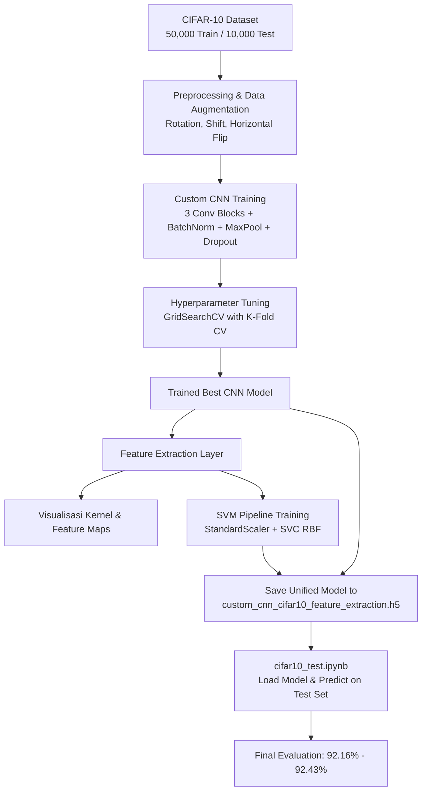

# 📷 CIFAR-10: Custom CNN Feature Extraction & SVM Classification

[](https://www.python.org/)
[](https://tensorflow.org/)
[](https://scikit-learn.org/)
[]()
[]()

Repository ini berisi implementasi pipeline klasifikasi citra pada dataset **CIFAR-10** menggunakan pendekatan gabungan **Deep Convolutional Neural Network (Custom CNN)** sebagai ekstraktor representasi fitur laten (*feature extractor*) dan **Support Vector Machine (SVM RBF)** sebagai pengklasifikasi akhir (*classifier*). 

Proyek ini dirancang secara terstruktur dengan memisahkan alur training/tuning hyperparameter secara komprehensif dan alur evaluasi data uji murni (*isolated test set evaluation*).

---

## 🌟 Highlight & Karakteristik Utama

- **Target Akurasi Terlampaui**: Target awal akurasi adalah $\ge 86.00\%$. Model berhasil mencapai akurasi **92.43%** pada CNN Kustom dan **92.16%** pada kombinasi CNN Feature Extractor + SVM RBF.
- **Tuning Hyperparameter dengan GridSearchCV**: Optimasi jumlah unit dense (`dense_units`) dan tingkat regularisasi (`dropout_rate`) menggunakan teknik K-Fold Cross Validation.
- **Single-File Unified Model (`.h5`)**: Arsitektur dan bobot CNN serta objek SVM Pipeline (`StandardScaler` + `SVC RBF`) tersimpan secara terpadu di dalam satu file model: `custom_cnn_cifar10_feature_extraction.h5`.
- **Evaluasi Murni (Strict Test Isolation)**: Notebook `cifar10_test.ipynb` hanya memuat data test ($10.000$ sampel) tanpa memuat data training dan tanpa ada proses fitting ulang (`fit()`).
- **Analisis Fitur Mendalam**: Dilengkapi visualisasi kernel/filter konvolusi serta ekstraksi *feature maps* lapisan konvolusi.

---

## 📊 Hasil Evaluasi & Performa

Pengujian dilakukan pada seluruh test set CIFAR-10 ($10.000$ citra pengujian):

| Model | Test Accuracy | Macro F1-Score | Status Target ($\ge 86.00\%$) |
| :--- | :---: | :---: | :---: |
| **CNN Kustom (Softmax)** | **92.43%** | **0.92** | ✅ **Tercapai (+6.43%)** |
| **CNN + SVM (RBF Kernel)** | **92.16%** | **0.92** | ✅ **Tercapai (+6.16%)** |

### Performa per Kelas (SVM Classifier)

```text
============================================================
              precision    recall  f1-score   support
============================================================
    Airplane       0.92      0.93      0.93      1000
  Automobile       0.96      0.96      0.96      1000
        Bird       0.90      0.91      0.90      1000
         Cat       0.84      0.83      0.83      1000
        Deer       0.92      0.94      0.93      1000
         Dog       0.87      0.86      0.86      1000
        Frog       0.95      0.95      0.95      1000
       Horse       0.95      0.94      0.94      1000
        Ship       0.95      0.96      0.96      1000
       Truck       0.94      0.95      0.94      1000
============================================================
    accuracy                           0.92     10000
   macro avg       0.92      0.92      0.92     10000
weighted avg       0.92      0.92      0.92     10000
```

---

## 🔬 Alur Kerja (Pipeline Architecture)



---

## 📁 Struktur Direktori

```plaintext
CIFAR10_Feature_Extraction_SVM_v2/
├── .gitignore                                 # Mengabaikan file checkpoint & cache jupyter
├── README.md                                  # Dokumentasi lengkap proyek
├── cifar10_train.ipynb                        # Training CNN, GridSearchCV, ekstraksi fitur & SVM training
├── cifar10_test.ipynb                         # Evaluasi murni data test menggunakan model tersimpan
└── custom_cnn_cifar10_feature_extraction.h5   # File model terpadu (Bobot CNN + Pipeline SVM)
```

---

## 🛠️ Instalasi & Persyaratan Sistem

Pastikan Anda memiliki environment Python (disarankan Python 3.9 - 3.10) dengan dependensi berikut:

```bash
pip install tensorflow scikit-learn numpy pandas matplotlib seaborn h5py
```

*Catatan: Jika menggunakan GPU, pastikan driver CUDA dan cuDNN yang sesuai telah terpasang.*

---

## 🚀 Cara Menjalankan

### 1. Training & Ekstraksi Fitur
Jalankan notebook training untuk melatih model dari awal:
```bash
jupyter notebook cifar10_train.ipynb
```
Notebook ini akan:
1. Memuat dan melakukan visualisasi dataset CIFAR-10.
2. Membangun model CNN baseline dan menjalankan **GridSearchCV**.
3. Melatih model terbaik dengan data augmentation dan callback (`EarlyStopping`, `ReduceLROnPlateau`).
4. Mengekstrak visualisasi filter dan feature maps.
5. Melatih SVM Classifier dan menyimpan model ke `custom_cnn_cifar10_feature_extraction.h5`.

### 2. Pengujian & Evaluasi Test Set
Jalankan notebook test untuk pengujian instan tanpa melatih ulang:
```bash
jupyter notebook cifar10_test.ipynb
```
Notebook ini akan:
1. Memuat hanya dataset pengujian ($10.000$ sampel).
2. Memuat model CNN dan SVM langsung dari file `.h5`.
3. Menghasilkan skor akurasi, perbandingan model, *confusion matrix*, dan *classification report*.

---

## 👤 Author
- **Daffa Fairuzza** - [@Daff77](https://github.com/Daff77)
